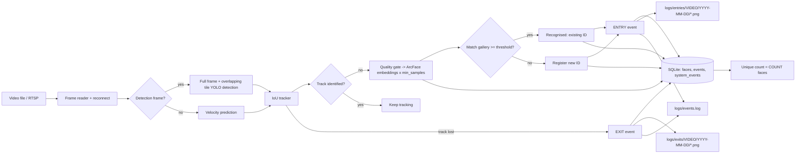

# Face Sync — Intelligent Visitor Analytics

Real-time pipeline that detects faces with **YOLOv8**, embeds them with **InsightFace (ArcFace)**, tracks them across frames, auto-registers new visitors, logs every entry/exit (image + timestamp + DB row + log line), and reports the number of **unique visitors**.

**Demo recording:** The current recording is shared from Google Drive:

- **Google Drive URL:** https://drive.google.com/file/d/1bOVYru1y3C3-Te80f_FdxEtXU7Jubrup/view?usp=sharing

Suggested walkthrough: select a sample video, show the annotated output and visitor counter, open one saved entry/exit image, show the corresponding `events.log` record, then show the visitor and audit tables in `data/visitors.db` and the final `report.py` output.

**Sections:** [Quick start](#quick-start-with-idle-windows) · [Results](#where-to-find-results) · [Configuration](#configuration) · [Planning](#ai-planning-and-features) · [Architecture](#architecture) · [Assumptions](#assumptions) · [Sample output](#sample-output) · [Submission checklist](#final-submission-checklist)

---

## Project folder

The project is located here:

```text
D:\PROJECT\FACE TRACKER\FACE SYNC
```

Run the commands below from this folder. Paths in the configuration are relative to this project folder.

## Quick start with IDLE (Windows)

Use IDLE with Python 3.11, the interpreter installed on this computer. The commands below are entered in the **IDLE Shell**, one line at a time; press Enter after each line. Do not paste the whole multi-line example at one prompt.

### 1. Check IDLE's Python interpreter

In the IDLE Shell, enter:

```python
import sys
print(sys.executable)
```

The path should point to your Python 3.11 installation. Packages must be installed for this same interpreter.

### 2. Install project packages once, if needed

If the project already starts without `ModuleNotFoundError`, skip this step. Otherwise, enter these lines separately in the IDLE Shell:

```python
import subprocess
import sys
subprocess.check_call([sys.executable, "-m", "pip", "install", "-r", r"D:\PROJECT\FACE TRACKER\FACE SYNC\requirements.txt"])
```

After installation, select **Shell → Restart Shell** in IDLE.

### 3. Start the Face Sync dashboard

1. In IDLE, select **File → Open**.
2. Open `D:\PROJECT\FACE TRACKER\FACE SYNC\ui.py`.
3. Select **Run → Run Module** or press **F5**.
4. In Face Sync, choose **Video**, browse to a video, and select **Start Tracking**.
5. Leave **Append to Previous Results** unchecked for a clean run. Check it only to retain previous visitor records.

When processing finishes, the dashboard displays the results and the pipeline prints its detailed report. `ui.py` starts the same pipeline implemented in `main.py`.

### Run the pipeline without the dashboard

To use the file picker and report without the UI, open `D:\PROJECT\FACE TRACKER\FACE SYNC\main.py` in IDLE and press **F5**. For an RTSP camera in the dashboard, select **RTSP** mode and enter the camera URL. To run RTSP through `main.py` in IDLE, edit the `input.mode` and `input.rtsp_url` values in `config.json` first, then open `main.py` and press **F5**. A normal video run prints its report automatically. To review saved results later, open `report.py` in IDLE and press **F5**.

### Run the test from IDLE

In the IDLE Shell, enter each line separately. Adding the project folder to `sys.path` lets the test import the `src` package when it is launched from IDLE:

```python
import os
os.chdir(r"D:\PROJECT\FACE TRACKER\FACE SYNC")
import sys
sys.path.insert(0, os.getcwd())
import unittest
suite = unittest.defaultTestLoader.discover("tests", top_level_dir=".")
unittest.TextTestRunner(verbosity=2).run(suite)
```

The test scene includes a face that returns within the configured 120-frame grace period. It expects **3 unique faces, 3 entry events, and 3 exit events**; the returning face resumes its visit instead of creating a duplicate event pair. The test recognizer returns no SCRFD proposals because the synthetic scene supplies detections through its fake detector.

### First launch notes

The requirements pin `scikit-image` below 0.26 to avoid the deprecation warning raised by InsightFace's current face-alignment code. On first launch, InsightFace downloads its `buffalo_l` model pack and needs internet access. The YOLO face model is included under `models/`; sample videos are under `data/`.

## Where to find results

| Result | Location |
|---|---|
| Visitor database | `D:\PROJECT\FACE TRACKER\FACE SYNC\data\visitors.db` |
| Mandatory event/audit text log | `logs/events.log` |
| Entry face crops | `logs/entries/<video-name>/YYYY-MM-DD/` |
| Exit face crops | `logs/exits/<video-name>/YYYY-MM-DD/` |
| Annotated video from the dashboard | `output/annotated/<video-name>_annotated.mp4` |
| Annotated video from `main.py` | Path configured by `output.annotated_video_path` in `config.json` |

The database has three main tables: `faces` (registered identities and embeddings), `events` (entry/exit time and image path), and `system_events` (tracking, recognition, registration, and audit details). In DB Browser for SQLite, open `data/visitors.db` and choose **Browse Data**.

## Dashboard overview

The Tkinter dashboard is branded **Face Sync**. It has a live monitor, searchable Visitors page, Reports page with per-face entry/exit timelines and CSV export, photo gallery, annotated-video launcher, and live activity/system-health panels. It uses the same pipeline as `main.py`; the dashboard is not a separate detection implementation. Tkinter is included with the standard Windows Python installer, so the dashboard adds no package dependency.

The “Append to Previous Results” checkbox is off by default, so a new dashboard run starts with a clean database and event log. Each run resets its frame and elapsed-time counters. Dashboard runs save annotated videos under `output/annotated/` using the selected video's name so separate videos do not overwrite one another.

When running from another working directory, config-relative paths resolve from the config file. The video picker opens under the project's `data/` folder. Stop a run using **Stop Safely** in the dashboard or Ctrl+C in the console; active identified tracks are finalized and the database is closed cleanly.

## Configuration

```json
{
  "input": { "mode": "video", "video_path": "data/sample1.mp4", "rtsp_url": "rtsp://...",
             "reconnect_attempts": 10, "reconnect_delay_sec": 3 },
  "detection": { "model_path": "models/yolov8n-face.pt", "conf_threshold": 0.10, "imgsz": 640,
                 "tile_inference": true, "tile_fraction": 0.50, "nms_iou_threshold": 0.50,
                 "nms_ios_threshold": 0.75, "nms_center_threshold": 0.60,
                 "device": "auto", "detection_skip_frames": 0,
                 "scrfd_fallback_interval": 3, "scrfd_fallback_size": 512 },
  "recognition": { "model_name": "buffalo_l", "similarity_threshold": 0.4,
                   "gallery_update_threshold": 0.6, "min_samples": 2, "max_attempts": 20,
                   "min_face_size": 18, "min_sharpness": 0.0,
                   "min_face_detection_score": 0.40, "min_embedding_box_iou": 0.08,
                   "max_landmark_offset_ratio": 0.80, "max_eye_vertical_offset_ratio": 0.70,
                   "det_size": 256, "det_threshold": 0.25,
                   "crop_margin": 0.3 },
  "tracking": { "iou_threshold": 0.3, "max_lost_frames": 30, "min_hits": 2,
                "reentry_grace_frames": 120 },
  "storage": { "db_path": "data/visitors.db", "logs_dir": "logs",
               "log_file": "logs/events.log", "reset_on_start": true },
  "output": { "show_window": false, "annotated_video_path": "output/annotated.mp4",
              "stats_every_n_frames": 30 }
}
```

For sample videos, YOLO scans the full frame plus four edge-aligned half-frame tiles at 640-pixel inference size on every frame (`detection_skip_frames: 0`). Box merging suppresses duplicates using IoU and a center-guarded intersection-over-smaller-area check, including boxes returned at different sizes by the tiled and fallback detectors. Every third detector pass also uses tiled InsightFace SCRFD proposals at 512-pixel input size, which can recover some small or angled faces missed by YOLO. The YOLO confidence threshold is 0.10 and the minimum face box size is 18 pixels; the recognition quality checks still require two valid embedding samples and plausible landmarks. Very small, blurred, occluded, profile, or back-of-head views can still be missed or rejected. Progress logs are emitted every 30 frames and include detection counts. For live RTSP, `config.rtsp.json` uses a lower-cost frame-skip configuration.

## AI planning and features

### Goal
Count unique visitors in a video/RTSP stream with exactly one ENTRY and one EXIT record per face appearance, without double-counting people who are re-identified.

### Features
1. YOLOv8 face detection on every sample-video frame with overlapping tiles (configurable; RTSP may skip frames for lower latency).
2. IoU + velocity tracker that keeps IDs stable across skipped frames.
3. ArcFace embeddings (InsightFace) with landmark alignment.
4. Quality gating (min size, sharpness) and multi-sample averaging (`min_samples`) before a face is identified, so one blurry frame never creates a fake visitor.
5. Auto-registration: no match above `similarity_threshold` creates a new face ID stored in the DB with its embedding.
6. Re-identification: matches against the gallery never increment the unique count.
7. Entry/exit logging: full-resolution, lossless PNG crops in `logs/entries/<video>/YYYY-MM-DD/` and `logs/exits/<video>/YYYY-MM-DD/`, plus a DB row and an `events.log` line containing event type, face ID, timestamp, and image path. RTSP images go under the `rtsp_stream` source folder.
8. Unique count = `SELECT COUNT(*) FROM faces`.
9. Critical audit trail: `system_events` stores tracking start/end, recognition, embedding generation, registration, entry, and exit with timestamps and structured metadata; matching audit IDs appear in `events.log`.
10. Resilience: SQLite WAL + FULL synchronous commits, graceful SIGINT/SIGTERM flush, RTSP auto-reconnect, and recovery of missing text-log lines from committed database rows. Image-save or entry/exit DB-write failures are logged as incomplete events rather than reported as successful events.
11. Annotated output video with live unique counter.
12. Face landmark quality checks reject detections with weak confidence, poor overlap,
    or strongly asymmetric/profile landmarks, while allowing moderate head angles. A 120-frame re-entry grace period suppresses
    duplicate entry/exit pairs caused by short detector or tracker gaps.

### AI-assisted development workflow
1. **Plan from the task:** identify the input sources, visitor identity rules, required entry/exit evidence, database fields, mandatory logs, and evaluation outputs before implementation.
2. **Design the modules:** keep source capture, tiled detection, tracking, face recognition, SQLite persistence, event logging, and reporting in separate modules with explicit configuration.
3. **Generate and review implementation:** use AI code generation to draft focused module changes, then review interfaces, failure handling, image paths, and database/log consistency against the requirements.
4. **Verify locally:** install `requirements.txt` for IDLE's Python interpreter, run the tests using the IDLE steps above, then run `main.py` with a sample video. Check the annotated output, event images, `logs/events.log`, and `data/visitors.db`; `main.py` prints the database/log report when processing finishes.
5. **Measure on the submission machine:** record the actual processing time/FPS and memory use for the chosen video and hardware. The compute values below are planning estimates, not benchmark results.

### Design decisions
- **Entry is logged only after identity is confirmed with at least `min_samples` valid embeddings**; tracks that end before then are discarded as too brief or low quality (logged as `TRACK DROPPED`).
- **Per-face live-track accounting**: a per-face reference count avoids duplicate events for overlapping tracks; a later re-entry can produce another ENTRY/EXIT pair, as required for separate appearances.
- **Face validation before embedding**: the InsightFace face box must overlap the YOLO box, meet the detector-confidence threshold, and have plausible five-point landmarks; this rejects unrelated faces in the expanded crop and strongly turned/back-of-head detections.
- **Distinct entry and exit evidence**: ENTRY saves the sharpest accepted crop; EXIT saves the latest observed crop so both events do not reuse the same earlier image.
- **Gallery embeddings** are updated with a slow moving average only on very confident matches.

### Estimated compute load (planning estimate; measure on your machine)
| Stage | Planning estimate |
|---|---|
| YOLOv8n-face | About 9 GFLOPs per 640-pixel inference input. The sample-video config submits one full frame and up to four tile inputs per processed frame, so a rough estimate is up to `5 × 9 ≈ 45 GFLOPs` per frame; actual cost depends on model, tile shapes, batching, and runtime. |
| InsightFace detection + ArcFace R50 | About 6 GFLOPs per embedding attempt; attempts run for unidentified tracks until recognition or the configured quality/attempt limit. |
| Tracker, database, logging | Small relative to neural inference; measure end-to-end because durable database commits and storage speed vary. |

Detection and recognition dominate runtime. These are planning estimates, not a measured benchmark; no CPU/GPU millisecond figures are claimed. On weak CPUs, disable `tile_inference` or increase `detection_skip_frames`; both trade detection coverage for speed.

## Architecture



```
main.py -> src/pipeline.py (orchestrator)
           ├── src/detector.py      YOLOv8 face detection
           ├── src/tracker.py       IoU + velocity tracking
           ├── src/recognizer.py    InsightFace ArcFace embeddings
           ├── src/database.py      SQLite (faces, events, system_events audit trail)
           └── src/event_logger.py  events.log + image store + DB events
```

## Assumptions
- Recognition requires a usable face crop; the configured detector minimum is 18 pixels, but very small or blurry crops may fail landmark/embedding quality checks. Back-of-head views are not treated as face identities.
- Cosine similarity threshold 0.40 for ArcFace `w600k_r50` is configured to reduce split identities in the sample; review the annotated video and registration similarities because a lower threshold can merge similar-looking people.
- A person leaving and returning later is the same visitor (one more ENTRY/EXIT pair, no count increase).
- Timestamps use the system clock at event time (works the same for files and RTSP).
- `reset_on_start: true` clears the DB and log on each run so counts reflect a single stream; set to `false` to keep visitors across restarts.

## Sample output

The SQLite database is `data/visitors.db` in the project folder. Open it in DB Browser for SQLite and choose **Browse Data** to view:

- `faces`: one row per registered identity (`face_id`, `label`, `first_seen`, and the stored embedding).
- `events`: entry/exit rows with event timestamp, face ID, track/frame IDs, and saved image path.
- `system_events`: audit rows for tracking, recognition, embedding generation, registration, entry, and exit, with JSON metadata.

The following is a **sample1 run previously recorded by the project** in `logs/events.log`. Local video, database, and face crops are excluded from this public repository because they contain face footage or biometric data. Run a sample video locally to regenerate database rows and image evidence:

```text
DONE | frames=240 | UNIQUE VISITORS=32 | events={'entry': 32, 'exit': 32}
EVENT | audit_id=35 | type=ENTRY | event_id=1 | face=FACE_0001 | timestamp=2026-10-04T16:48:05.392 | track=1 frame=3 | image=...\logs\entries\sample1\2026-10-04\FACE_0001_ENTRY_04-10-2026_16-48-05.png
```

This is an example from a prior run, not a guaranteed count for another video. Its image path is historical; face-crop files were cleared from the working copy before publication and are recreated when you run a video locally. `report.py` also prints the database count and each face's entry/exit timeline when you run it. A typical current event-log record looks like:

```text
EVENT | audit_id=... | type=ENTRY | event_id=... | face=FACE_0001 | timestamp=... | track=1 frame=7 image=...
```

At the end of a run, the automatic report lists each face's entry and exit timestamps, including repeat visits. The output format is:

```text
Per-face entry/exit timeline:
  FACE_0001 (face_id=1) | first_seen=2026-10-04T16:48:05.390
    Entry times (1):
      - 2026-10-04T16:48:05.392
    Exit times (1):
      - 2026-10-04T16:51:48.695
```

These timestamps are from the sample1 run shown above.

The current code writes new crops under the source-and-date structure, such as `logs/entries/sample1/2026-10-04/` and `logs/exits/sample1/2026-10-04/`, using full-resolution PNG files. The corresponding database rows use this schema:

| Table | Example fields |
|---|---|
| `faces` | `face_id=1`, `label=FACE_0001`, `first_seen=<registration timestamp>`, `embedding=<stored float32 vector>` |
| `events` | `event_type=entry`, `timestamp=2026-10-04T16:48:05.392`, `face_id=1`, `track_id=1`, `frame_idx=3`, `image_path=<saved PNG crop path>` |
| `system_events` | `event_type=entry`, `timestamp=2026-10-04T16:48:05.392`, `face_id=1`, `track_id=1`, `frame_idx=3`, `metadata={"event_id": 1}` |

`storage.reset_on_start` is `true` in the supplied configuration, so back up `data/visitors.db` and `logs/` before a clean run if you need to retain this sample evidence.

## Final submission checklist

- Run the regression checks from IDLE using the steps above.
- Run a sample video and confirm the annotated video, entry/exit crops, `logs/events.log`, and `data/visitors.db` are produced and agree with the automatic report.
- Confirm the demo recording is viewable to reviewers. Check with the organizers whether the provided Drive link is acceptable because the brief names Loom or YouTube.
- Keep sample videos, visitor database embeddings, and identifiable face crops local; they are excluded by `.gitignore`. Run a video locally to generate fresh evidence for your assessment/demo.
- Push the final project and this README to GitHub, then submit the repository URL and required assessment details in the hackathon form.

---

This project is a part of a hackathon run by https://katomaran.com

